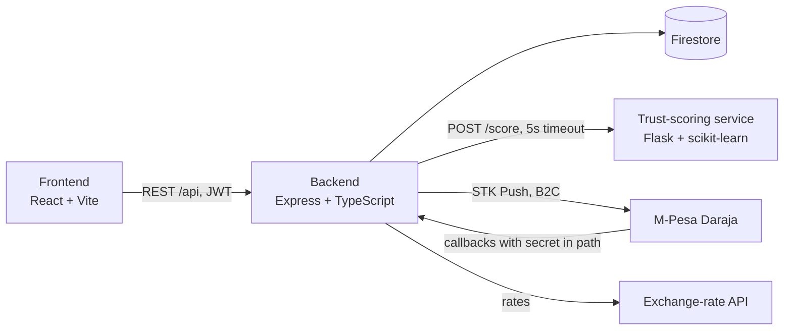
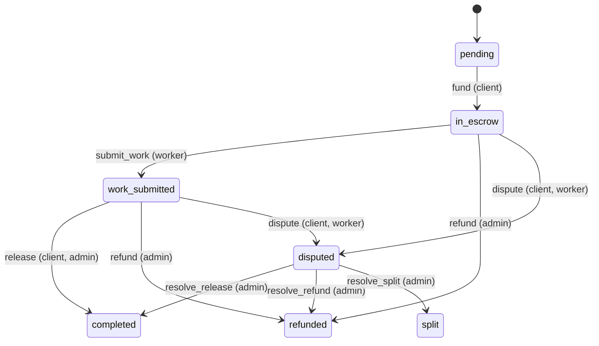

# Architecture

An escrow-based wallet and payment system for digital labour platforms. Clients fund a job into escrow, the worker delivers, and the money is released to the worker, refunded, or split by an admin after a dispute. A Random Forest trust score for each user comes from a separate Python service.

## Components

| Component | Folder | Role |
|---|---|---|
| Frontend | [`frontend/`](../frontend/) | Single-page app with Client, Worker and Admin areas. Calls the backend only; the session token is kept in `localStorage` |
| Backend | [`backend/`](../backend/) | Business rules, auth, wallets, escrow, payments, jobs, disputes, KYC. All writes go through it |
| Trust-scoring service | [`trust-scoring-ml/`](../trust-scoring-ml/) | `GET /health`, `POST /score`. Loads the worker or client model by role |
| Firestore | managed by Firebase | The only database. Indexes in `backend/firestore.indexes.json` (config in `backend/firebase.json`) |
| Daraja | external | STK Push for funding a wallet, B2C for worker withdrawals (sandbox) |
| Exchange-rate API | external | USD-based rates for KES, UGX, TZS and USD display |

## Escrow lifecycle

The rules live in one pure module, `backend/src/services/escrowStateMachine.ts`. Services only apply the wallet changes it returns, inside a Firestore transaction.

Wallet effect: `fund` moves the amount from the client's `balance` to their `escrowBalance`; `release` moves it to the worker's `balance`; `refund` returns it to the client; `split` divides it by the admin's amounts. Every other transition changes no money.

## Data model (Firestore)

| Collection | Holds |
|---|---|
| `clients`, `workers`, `admins` | One collection per role: profile, password hash, terms acceptance, optional `trustStats` override |
| `emails`, `phones` | Unique-key index so an email or phone is registered once |
| `wallets` | `balance` and `escrowBalance` per user, in KES |
| `jobs`, `applications` | Posted jobs (location, photos, budget) and worker applications |
| `escrows` | One per funded job: client, worker, amount, status, timestamps |
| `disputes`, `refundRequests` | Raised problems and client refund requests, resolved by an admin |
| `transactions` | Ledger of every wallet movement, used for history and statements |
| `payments`, `withdrawals` | STK Push and B2C requests with their Daraja status |
| `kyc`, `kycFiles`, `kycIdIndex`, `kycAccessLog` | Worker identity check, the stored photos, a one-ID-one-account index, and a log of who viewed a submission |

The UML class and ER diagrams from the proposal are kept outside this repository.

## Key flows

**Fund a job.** The client picks a worker (`POST /api/jobs/:id/select`) and pays (`POST /api/escrow/fund`). If the wallet balance covers it the escrow is funded immediately. Otherwise `POST /api/payments/stk-push` (with the job and worker) sends an M-Pesa prompt; when Daraja calls back successfully, the wallet is credited and the escrow funded in one transaction.

**Complete a job.** The worker marks the work done (`POST /api/escrow/:jobId/complete`, event `submit_work`), the client releases payment (`POST /api/escrow/:jobId/confirm`, event `release`), and the transaction ledger and both wallets are updated together.

**Dispute or refund.** Either party can dispute an escrow that is in escrow or submitted. An admin resolves it as release, refund or split (`POST /api/escrow/:jobId/resolve-dispute`). A client can also file a refund request (`refund-request`), which an admin processes (`process-refund`).

**Withdraw.** A verified worker withdraws to M-Pesa (`POST /api/payments/withdraw`). The backend starts a B2C payout and settles the withdrawal when Daraja posts the result or timeout callback. Withdrawals past `TAX_PIN_THRESHOLD_KES` a year need a tax PIN on file.

**Trust score.** The backend works the model inputs out from the user's settled jobs, disputes and timings, then calls `POST /score` on the Flask service. A user with fewer than 3 settled jobs is "New" and the model is not called. If the service is down or slow (5 seconds) the endpoint returns `503`; no other flow depends on it.

## Security

- **Auth:** passwords hashed with bcrypt; login returns a signed JWT. `authenticate` checks it and `requireRole` enforces Client, Worker or Admin access per route.
- **Terms gate:** money-moving routes use `requireTerms`, which rejects users who have not accepted the current terms version.
- **Daraja callbacks:** Daraja does not sign requests, so each callback URL contains a random secret that the route checks.
- **KYC data:** identity photos are stored separately from profiles, and every admin view of a submission is logged.
- **Secrets:** all configuration comes from environment variables; `.env` and service account keys are git-ignored.
- **Simulation mode:** `DARAJA_SIMULATE` is ignored when `NODE_ENV=production`.

## Further reading

- [Module map](modules.md): which routes, services, collections and screens belong to each module
- [Setup guide](setup-guide.md)
- [Backend API reference](../backend/README.md)
- [Frontend notes](../frontend/README.md)
- [Trust-scoring service](../trust-scoring-ml/README.md)
